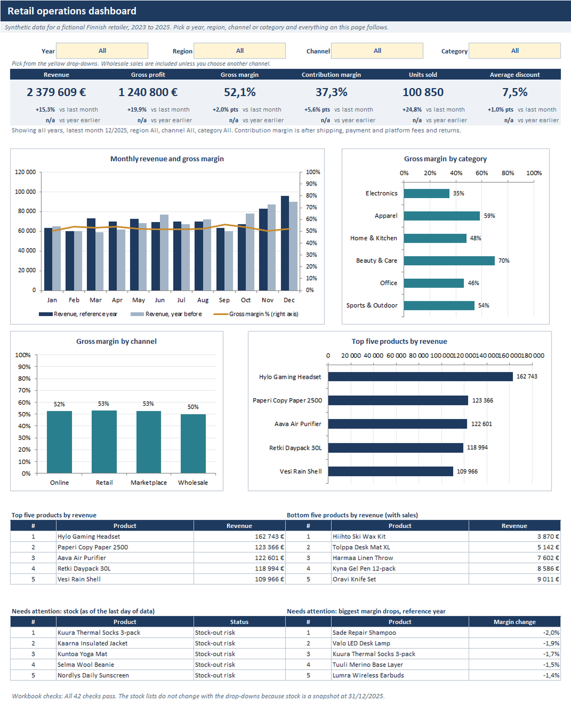
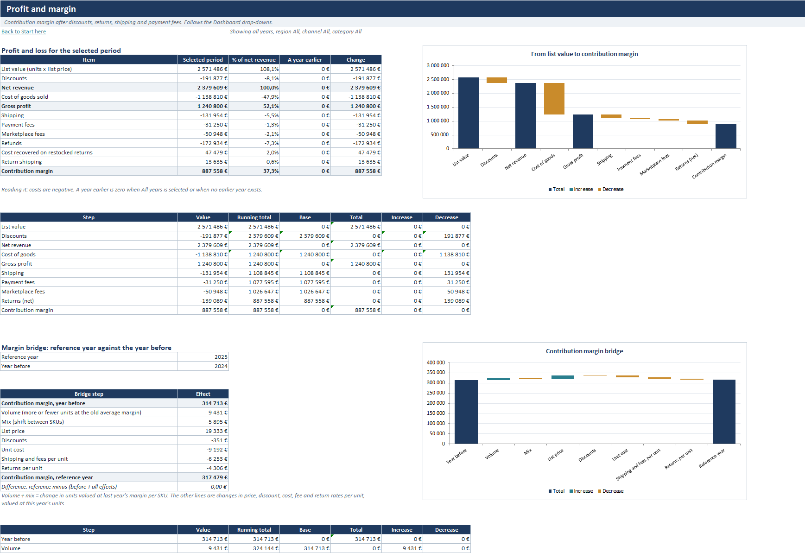
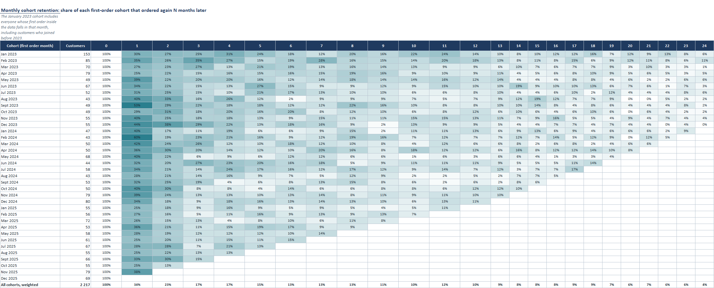

# Excel Retail Operations Dashboard

> All the data here is made up. The company, the products, the suppliers and the customers are invented, and nobody real is described. The numbers say nothing about a real shop.

I built this to practise the kind of analysis a retail or operations analyst gets asked for. The workbook runs on three years of invented sales for a Finnish shop that sells online, in stores, on a marketplace and wholesale. A set of Python scripts works out the same numbers from the CSV files, which is how I checked the workbook.

The numbers in the screenshots are formatted the way the PC they were taken on formats them: a space as the thousands separator and a comma as the decimal mark. The workbook follows the regional settings of whoever opens it. This README uses English formatting, a comma for thousands and a point for decimals.

The first version covered one year and sits untouched in [`v1/`](v1/). It had some mistakes, and [`CHANGELOG.md`](CHANGELOG.md) says which.

## Screenshots

Taken from the workbook in desktop Excel. There are ten in [`screenshots/`](screenshots/).






## What it tries to answer

Where does the margin go once shipping, fees, discounts and returns are counted? What changed it between two years? Which products carry the revenue? What needs reordering, what is sitting on the shelf, and what did empty shelves cost? Which forecasting method suits each category? Do promotions pay for themselves, and what if prices, suppliers or demand change? Who comes back, and how fast do new customers drop off?

## What came out

Each figure comes from the script named in `outputs/key_findings.csv`. The data is synthetic, so these show what the workbook can do and say nothing about real retail.

Gross margin over the three years is 52.1%, but contribution margin, after shipping, fees and returns, is 37.3%. Retail keeps 49.0% and the marketplace only 24.2%.

Contribution margin went from 314,713 euros in 2024 to 317,479 in 2025 (+2,766). Higher list prices added 19,333 and higher unit costs took away 9,192.

Stock-outs cost 2,088 units in 2025, 5.4% of demand, roughly 49,737 euros of sales. On the last day 4 SKUs are at their reorder point, 10 more have less cover than their lead time, and 10 are overstocked.

Of 73 promotions with a usable baseline, 35 added gross profit and 38 lost it, for -3,838 euros together. The baseline ignores seasonality, so that is a rough figure.

Apparel returns 12.6% of units and office goods 2.0%. Returns cost 139,089 euros, 5.8% of revenue. The worst single SKU, a pair of jeans, comes back 21.6% of the time.

72% of the 2,217 consumers who bought did so more than once, and 47% of the 2024 buyers came back in 2025. Champions are 19% of scored customers and bring in 40% of their revenue.

## How it was built

`tools/generate_data.py` makes the data from a seed: 42 SKUs in 6 categories, 5 regions, 4 channels and 4,000 customers, with seasonality, promotions, returns, supplier delays and stock-outs. It also writes a deliberately messy sales export (duplicates, missing values, wrong dates) to `data/raw/`, and `tools/clean_data.py` repairs it and logs every change.

`tools/build_workbook.py` writes the workbook with XlsxWriter. The calculations are live formulas over Excel tables, with named ranges, drop-downs, conditional formats and charts, and every input sits on the Assumptions sheet. The PivotTable and the Power Query sheet were added by hand in Excel afterwards.

For checking, the Checks sheet runs 42 tests against the CSV files and against itself. `tools/verify_workbook.py` recalculates the workbook in LibreOffice and compares 1,415 figures with pandas. The pytest suite is in `tests/`.

## What I would do next

Try it on a real extract and see which assumptions break first. Take seasonality out of the promotion baseline and estimate elasticity properly instead of averaging lifts. Test the forecast on more than three held-back months. Model stock by region, and put returns back into stock.

## Limits

- The data is synthetic and was built from the same rules the analysis finds again. That shows the method works, not that it works on real data.
- I tested in desktop Excel on Windows and in LibreOffice. Mac Excel, Excel for the web and Google Sheets were not tried. [`docs/manual-steps.md`](docs/manual-steps.md) has the details.
- The workbook holds sales by month, SKU, region and channel. Order lines are in the CSV files.
- About three quarters of order lines have no customer id, so the customer work covers identified customers only.
- Building the workbook again with the script drops the PivotTable and Power Query sheets.

## Folder map

```
Excel_Retail_Operations_Dashboard_v2.xlsx   the workbook
README.md  CHANGELOG.md  LICENSE  requirements.txt
data/        CSV files, and data/raw/ with the messy export and the cleaning log
tools/       generate_data.py, clean_data.py, check_data.py, build_workbook.py, verify_workbook.py
analysis/    the workbook's calculations again in pandas, one script per topic
tests/       pytest suite
docs/        walkthrough.md, methodology.md, data-dictionary.md, manual-steps.md
outputs/     CSV results (two decimals, shares as percentages in columns ending _pct), charts, data checks and the workbook comparison
screenshots/ ten images taken from the workbook in Excel
v1/          version 1, untouched
```

## Opening it

Open `Excel_Retail_Operations_Dashboard_v2.xlsx` in Excel 2010 or later and choose Enable Editing if asked. Start on `Start_Here`, then try the yellow drop-downs on `Dashboard`. Inputs are on `Assumptions`. Every row on `Checks` should say PASS.

## Reproducing it

```
pip install -r requirements.txt
python tools/generate_data.py
python tools/clean_data.py
python tools/check_data.py
python analysis/run_all.py
python tools/build_workbook.py
python -m pytest tests
```

`tools/verify_workbook.py` needs LibreOffice and takes several minutes. Add `--no-values` to `build_workbook.py` to skip the LibreOffice pass that stores calculated values in the file.
