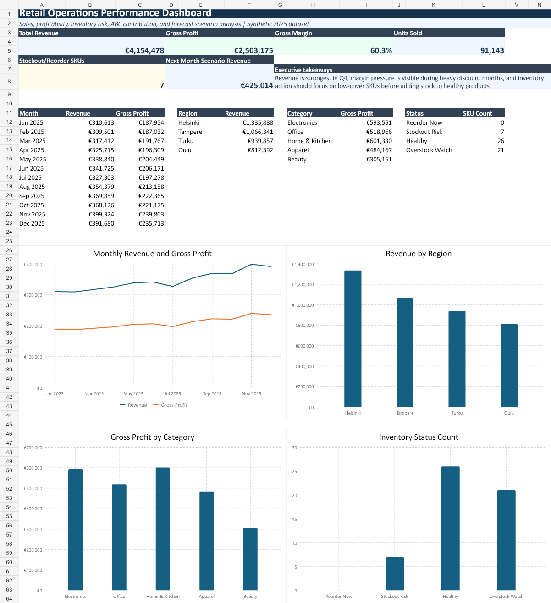

# Advanced Excel Retail Operations Dashboard

An advanced Excel portfolio project for sales, profitability, inventory risk, ABC product contribution, and demand forecasting analysis.

This project uses a fictional retail/e-commerce company and synthetic 2025 data. It is designed to demonstrate practical Excel business analytics skills for data analyst, business analyst, operations analyst, and IT analyst roles.

## Project Objective

The goal is to turn raw sales and inventory data into an executive-ready Excel dashboard that helps answer:

- Which months, regions, and product categories drive revenue?
- How profitable is the business after discounts and unit costs?
- Which inventory items are at risk of stockout or overstock?
- Which products contribute most to total revenue?
- What is the next-month revenue forecast under a demand uplift scenario?

## Workbook Features

- Executive KPI dashboard
- Native Excel charts for revenue, gross profit, region performance, and inventory status
- Transaction-level sales dataset
- SKU and warehouse-level inventory analysis
- Monthly sales and profitability summary
- ABC product contribution analysis
- Three-month moving average forecast model
- Scenario uplift assumption
- Conditional formatting for inventory risk
- Structured tables, filters, formulas, and clean workbook navigation

## Files

| File | Description |
|---|---|
| `Advanced_Excel_Retail_Operations_Dashboard.xlsx` | Main Excel workbook |
| `data/sales_transactions_2025.csv` | Synthetic transaction-level sales data |
| `data/product_master.csv` | Product, category, cost, price, supplier, and reorder assumptions |
| `data/inventory_snapshot.csv` | SKU and warehouse-level inventory snapshot |
| `screenshots/dashboard_preview.png` | Dashboard preview for GitHub |
| `screenshots/monthly_summary_preview.png` | Monthly summary preview |
| `methodology.md` | Explanation of the analysis logic and model design |
| `GITHUB_UPLOAD_GUIDE.md` | Step-by-step GitHub upload instructions |

## Key Metrics Included

- Total revenue
- Gross profit
- Gross margin %
- Units sold
- Revenue per order
- Average discount %
- Inventory value
- Days of cover
- Reorder and stockout risk flags
- Product revenue share
- Cumulative revenue contribution
- ABC class
- Scenario-based next-month revenue forecast

## Tools Used

- Microsoft Excel
- Excel formulas
- Structured tables
- Conditional formatting
- Native Excel charts
- CSV-based sample data
- Business analysis and dashboard design

## How To Use

1. Download or open `Advanced_Excel_Retail_Operations_Dashboard.xlsx`.
2. Start from the `Dashboard` sheet for the executive view.
3. Review `Sales_Data` and `Inventory_Data` for the source data.
4. Change assumptions in the `Assumptions` sheet, especially the scenario demand uplift.
5. Check `Forecast_Model` to see how the forecast changes.
6. Use filters in the data sheets to explore specific regions, channels, categories, products, or warehouses.

## Data Privacy

All data in this project is synthetic and created for portfolio demonstration only. It does not contain real employer, customer, supplier, sales, or fundraising data.

## Portfolio Positioning

This project demonstrates advanced Excel analytics beyond basic reporting. It shows the ability to build a reusable decision-support workbook, connect operational data to business questions, and present insights clearly for non-technical stakeholders.
